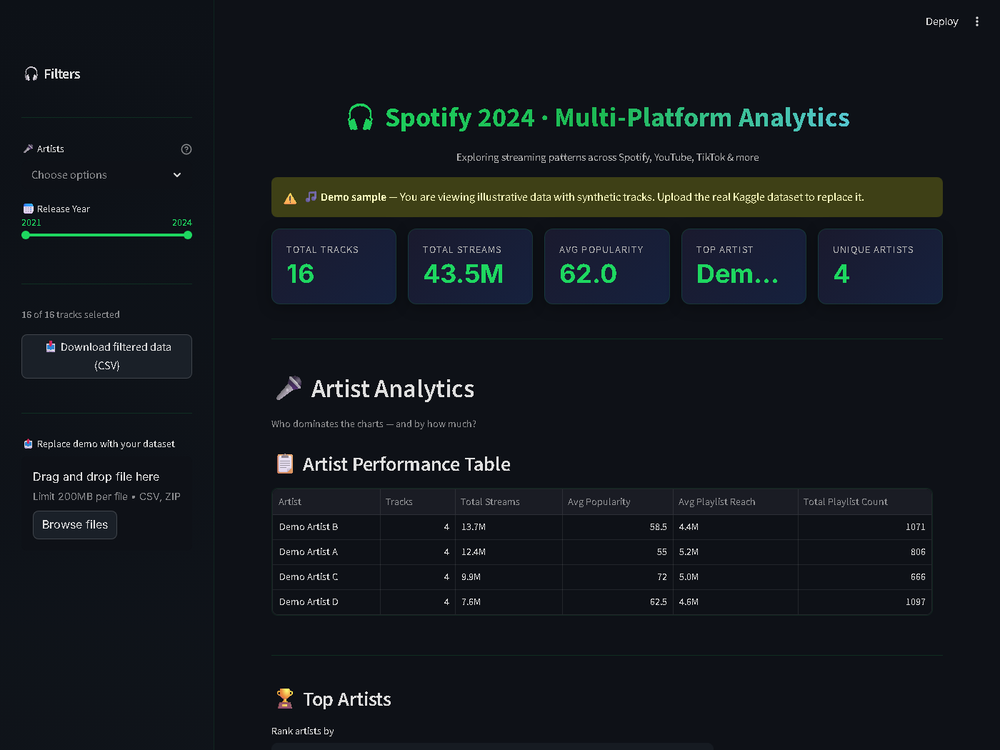
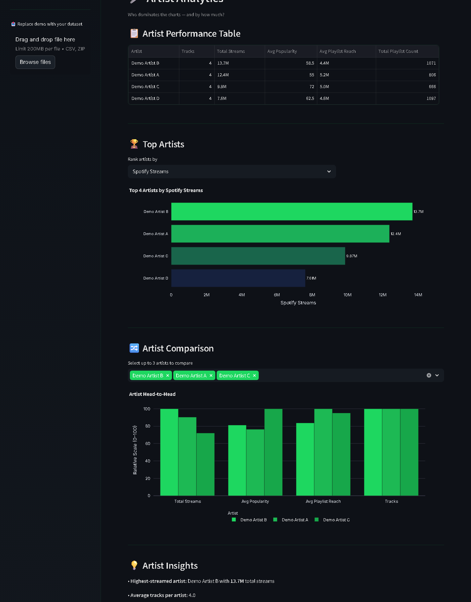
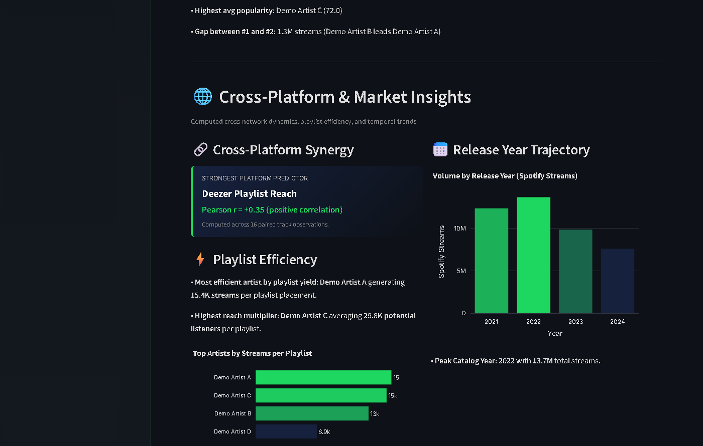
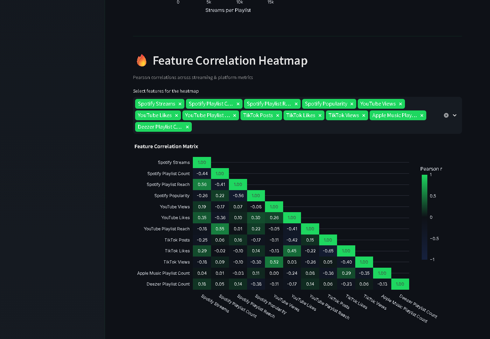

# 🎧 Spotify Multi-Platform Analytics Dashboard

[](https://github.com/codebyzerone/spotify-multi-platform-analytics/actions)
[](https://www.python.org/)
[](https://streamlit.io/)
[](LICENSE)

An interactive, production-grade analytics dashboard built with **Python**, **Streamlit**, and **Plotly** to explore music performance and audience dynamics across multiple platforms (Spotify, YouTube, TikTok, Apple Music, Deezer, Amazon Music, and Shazam) using the **Spotify Most Streamed Songs 2024** dataset.

The application features a modular architecture, fully vectorized data transformation pipelines, automated statistical insights, responsive dark-themed visualizations, and an instant **Demo Mode** for zero-download onboarding.

---

## 📸 Dashboard Preview

### 1. Dashboard Overview & Executive KPIs
Metric summary cards, reactive sidebar filters, and artist performance table with formatted large-number metrics.


### 2. Head-to-Head Artist Analytics & Auto-Insights
Normalized multi-metric comparison, Top-N rank sliders, and computed insight summaries.


### 3. Cross-Platform Synergy & Market Efficiency
Automated identification of strongest external platform correlation drivers, playlist yield efficiency, and release year catalog trends.


### 4. Feature Correlation Matrix
Lower-triangle Pearson correlation heatmap analyzing cross-platform streaming and audio feature relationships.


---

## ✨ Key Features

- **🚀 Instant Demo Mode:** Explore the entire dashboard with zero setup. Generates 16 realistic synthetic tracks across multiple artists and release years with full platform coverage.
- **⚡ Vectorized Data Cleaning:** Automatically strips whitespace, normalizes audio feature variants (`Danceability %`, `danceability_%`), coerces comma-formatted numeric strings, imputes missing values using column medians, and extracts calendar years from mixed date formats.
- **🎤 Artist Head-to-Head Analytics:** Compare up to 3 artists simultaneously on a normalized 0–100 relative scale across streams, playlist reach, popularity, and track counts.
- **🌐 Cross-Platform Correlation Engine:** Computes Pearson correlation coefficients ($r$) between Spotify streams and external networks (YouTube, TikTok, Deezer, etc.) to highlight leading indicators of streaming volume.
- **📊 Streaming Efficiency Metrics:** Calculates streams per playlist placement and audience reach multipliers per artist.
- **📅 Catalog Trajectory:** Aggregates and plots catalog stream volume across release years.
- **📥 Filtered Data Export:** One-click download of the currently filtered DataFrame directly from the sidebar as a clean CSV.
- **🛡️ Robust Error Handling:** Graceful error messages for corrupt ZIP archives, undecodable files, missing columns, and empty filter slices—no unhandled tracebacks.

---

## 📂 Project Architecture

The codebase follows a modular separation of concerns between data loading, business logic, visual components, and utilities:

```text
spotify-multi-platform-analytics/
├── app.py                      # Application entry point & layout coordinator
├── data_loader.py              # Vectorized loading, encoding fallback, cleaning & demo generator
├── requirements.txt            # Tested, version-bounded dependencies
├── LICENSE                     # MIT License
├── README.md                   # Project documentation
├── .streamlit/
│   └── config.toml             # Custom Spotify dark theme & upload size configs
├── .github/
│   └── workflows/
│       └── ci.yml              # Multi-version Python GitHub Actions CI
├── components/                 # Focused UI rendering modules
│   ├── __init__.py
│   ├── kpis.py                 # Top-level KPI metric cards
│   ├── sidebar.py              # Interactive filtering & dataset replacement
│   ├── artist.py               # Performance table, Top-N charts & artist comparisons
│   ├── insights.py             # Cross-platform synergy, playlist efficiency & YoY trends
│   ├── correlation.py          # Lower-triangle correlation heatmap
│   └── distributions.py        # Distribution histograms, violins & track rankings
├── utils/                      # Shared helper functions & theme definitions
│   ├── __init__.py
│   ├── theme.py                # Plotly layout dictionary, Spotify palette & CSS
│   ├── formatting.py           # Large number abbreviation (K/M/B/T) & column resolution
│   └── charts.py               # Styled Plotly horizontal bar chart factory
├── tests/                      # Automated unit test suite
│   ├── __init__.py
│   ├── test_data_loader.py     # Tests for cleaning pipeline, date parsing, ZIPs & demo data
│   └── test_insights.py        # Tests for correlation drivers & efficiency calculations
├── docs/                       # Project planning and demo artifacts
│   ├── UPGRADE_PLAN.md         # Comprehensive engineering upgrade specification
│   └── demo-script.md          # 90-second video demo walkthrough script
└── images/                     # Real, verified dashboard screenshots
    ├── dashboard_overview.png
    ├── artist_analytics.png
    ├── market_insights.png
    ├── correlation_heatmap.png
    └── full_dashboard.png
```

---

## 🚀 Quick Start

### 1. Clone the repository

```bash
git clone https://github.com/codebyzerone/spotify-multi-platform-analytics.git
cd spotify-multi-platform-analytics
```

### 2. Create and activate a virtual environment

```bash
# On macOS / Linux:
python -m venv .venv
source .venv/bin/activate

# On Windows (PowerShell):
python -m venv .venv
.venv\Scripts\Activate.ps1
```

### 3. Install dependencies

```bash
pip install -r requirements.txt
```

### 4. Run the dashboard

```bash
streamlit run app.py
```

On first run without a dataset, click **"Load demo sample"** to test the entire application immediately.

---

## 🧪 Running the Test Suite

The test suite covers data cleaning, column normalisation, numeric coercion, date parsing, null dropping, ZIP handling, corrupt upload validation, and analytical calculations:

```bash
pytest -v tests/
```

Example output:
```text
tests/test_data_loader.py::test_whitespace_stripping PASSED              [  7%]
tests/test_data_loader.py::test_audio_pct_normalisation PASSED           [ 14%]
tests/test_data_loader.py::test_numeric_coercion_with_commas PASSED      [ 21%]
tests/test_data_loader.py::test_date_parsing_and_release_year PASSED     [ 28%]
tests/test_data_loader.py::test_median_fill_for_nans PASSED              [ 35%]
tests/test_data_loader.py::test_all_null_row_dropping PASSED             [ 42%]
tests/test_data_loader.py::test_zip_loading PASSED                       [ 50%]
tests/test_data_loader.py::test_demo_dataframe_cleanable PASSED          [ 57%]
tests/test_data_loader.py::test_validate_required_columns PASSED         [ 64%]
tests/test_data_loader.py::test_corrupt_upload_handling PASSED           [ 71%]
tests/test_insights.py::test_cross_platform_driver_computation PASSED    [ 78%]
tests/test_insights.py::test_cross_platform_driver_missing_spotify PASSED [ 85%]
tests/test_insights.py::test_platform_efficiency_computation PASSED      [ 92%]
tests/test_insights.py::test_platform_efficiency_zero_playlists PASSED   [100%]

============================= 14 passed in 2.15s ==============================
```

---

## ☁️ Deployment (Streamlit Community Cloud)

This repository is ready to deploy with **zero secrets or external API configuration**:

1. Fork or push this repository to GitHub.
2. Sign in to [Streamlit Community Cloud](https://share.streamlit.io/).
3. Click **"New app"** and select:
   - **Repository:** `your-username/spotify-multi-platform-analytics`
   - **Branch:** `main` (or `spotify-upgrades`)
   - **Main file path:** `app.py`
4. Click **"Deploy!"**.
5. The application boots directly into **Demo Mode** with interactive data. Users can also upload their real Kaggle dataset directly through the file uploader.

---

## 📊 Dataset Provenance & Redistribution Policy

This project is designed around the **Spotify Most Streamed Songs 2024** dataset published on Kaggle by Nelgiriya Withana.

> [!IMPORTANT]
> **Why the real dataset is not committed to git:**
> The Kaggle dataset is subject to its original publisher's license terms and is **not committed to this repository**.
> Instead, this project includes a synthetic demo data generator that passes through the exact same cleaning pipeline.

To run with real Kaggle data:
1. Download the CSV from [Kaggle – Most Streamed Spotify Songs 2024](https://www.kaggle.com/datasets/nelgiriyewithana/most-streamed-spotify-songs-2024).
2. Place the file at `data/spotify_2024.csv` (or upload it via the dashboard).
3. The dashboard will automatically detect and load it.

---

## 🛠 Tech Stack

| Technology | Purpose |
|------------|---------|
| **Python 3.10+** | Core programming language |
| **Streamlit 1.55+** | Interactive web dashboard framework |
| **Pandas 2.2+** | Vectorized tabular data transformation & aggregation |
| **NumPy 1.26+** | Numerical operations and statistical matrix masking |
| **Plotly 6.6+** | Dark-themed responsive charts and interactive heatmaps |
| **pytest 9.2+** | Automated testing framework |
| **GitHub Actions** | Automated CI pipeline across Python 3.10, 3.11, and 3.12 |

---

## 📄 License

Distributed under the **MIT License**. See [LICENSE](LICENSE) for details.

---

## 👨‍💻 Author

**Manodip Bhattacharjee**  
Computer Science Engineering Student  
- GitHub: [codebyzerone](https://github.com/codebyzerone)  
- LinkedIn: [manodip-bhattacharjee](https://www.linkedin.com/in/manodip-bhattacharjee-651b09360)
